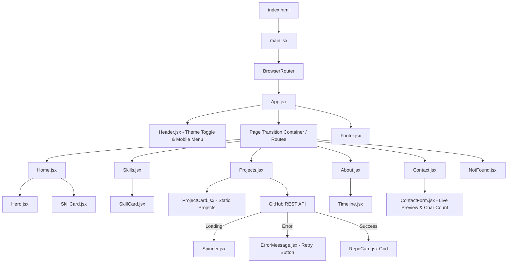
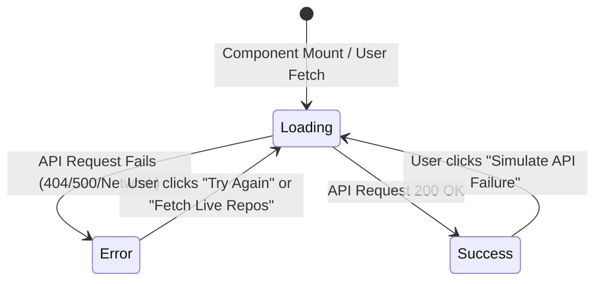

# 🌐 Krish Bhingradiya — Personal Portfolio & Academic Practical

<p align="center">
  
  
  
  
  
  
</p>

<p align="center">
  A high-performance, fully responsive, and modern Personal Portfolio Web Application built with <b>React 19</b>, <b>Vite</b>, and pure <b>Vanilla CSS</b> (no CSS utility frameworks). Engineered for clean component architecture, seamless multi-page client-side routing, theme persistence, interactive forms, and end-to-end <b>GitHub REST API integration</b> with complete asynchronous lifecycle handling.
</p>

---

## 📑 Table of Contents

- [📌 Project Overview](#-project-overview)
- [🎯 Practical & Academic Objectives](#-practical--academic-objectives)
- [✨ Key Features & Implementation Highlights](#-key-features--implementation-highlights)
- [🏗️ Architectural Hierarchy](#️-architectural-hierarchy)
- [💻 Tech Stack & Tools](#-tech-stack--tools)
- [🌐 REST API Integration (Practical 3 Specification)](#-rest-api-integration-practical-3-specification)
- [📂 Directory & Project Structure](#-directory--project-structure)
- [⚙️ Getting Started & Local Development](#️-getting-started--local-development)
- [🧪 Scripts & Code Quality](#-scripts--code-quality)
- [🎨 Design System & Styling Architecture](#-design-system--styling-architecture)
- [👨‍💻 Author & Academic Information](#-author--academic-information)
- [📄 License](#-license)

---

## 📌 Project Overview

This repository houses the personal developer portfolio and practical submission for **Krish Bhingradiya** (B.Tech Information Technology, CHARUSAT University). 

The goal of this project is to showcase production-grade frontend engineering practices using modern React concepts:
- **Clean Component Modularization**: Decomposed into single-responsibility components and page views.
- **Client-Side Routing**: True Single-Page Application (SPA) routing with dynamic URL matching and fallback handling.
- **Robust Asynchronous State Management**: Handling real-world data fetching with loading spinners, descriptive error messaging, manual retry mechanisms, and API failure simulation.
- **Vanilla CSS Mastery**: Modern UI crafted completely without Tailwind, Bootstrap, or Material UI, utilizing CSS Custom Properties (variables), CSS Grid, Flexbox, glassmorphism backdrop filters, and CSS keyframe animations.
- **User-Centric Interactions**: Real-time form input previews, live character counting, contextual tooltips, and persistent dark/light theme switching.

---

## 🎯 Practical & Academic Objectives

This project strictly adheres to and demonstrates the learning outcomes expected in modern web development lab practicals:

| Practical Requirement | Implementation in Project | Status |
| :--- | :--- | :---: |
| **Component-Driven Architecture** | Decomposed reusable UI components (`Header`, `Hero`, `ProjectCard`, `RepoCard`, `SkillCard`, `Timeline`, `ContactForm`, `Spinner`, `ErrorMessage`, `Footer`) | ✅ Completed |
| **Multi-Route Navigation (SPA)** | React Router DOM configuration with declarative routes (`/`, `/skills`, `/projects`, `/about`, `/contact`, `*`) | ✅ Completed |
| **State & Lifecycle Management** | Effective use of `useState`, `useEffect`, and `useCallback` for local state, lifted state, and asynchronous data fetching | ✅ Completed |
| **External REST API Integration** | Public GitHub REST API integration to dynamically fetch, parse, and render user repositories | ✅ Completed |
| **Async State Lifecycle Handling** | Distinct UI rendering for all 3 async states: **Loading** (`<Spinner />`), **Error** (`<ErrorMessage />`), and **Success** (`<RepoCard />` grid) | ✅ Completed |
| **Resilience & Testing UI** | Dedicated "Simulate API Failure" and "Fetch Live Repos" buttons + instant "Try Again" retry action | ✅ Completed |
| **Controlled Forms & Real-time State** | Two-way data binding in contact form with real-time card preview and dynamic character counter | ✅ Completed |
| **Persistent Theme Switching** | Light/Dark theme toggle with automatic synchronization to `localStorage` and `document.documentElement` | ✅ Completed |
| **Zero CSS Framework Constraint** | 100% custom styling written using semantic CSS3 rules, media queries, and design tokens | ✅ Completed |

---

## ✨ Key Features & Implementation Highlights

### 1. 🌓 Persistent Theme Switcher (Dark & Light Mode)
* Implemented via lifted state in [`App.jsx`](src/App.jsx).
* Synchronized with `localStorage` so the user's preference is remembered across sessions.
* Toggles CSS classes on `document.documentElement`, shifting color tokens defined in [`variables.css`](src/css/variables.css).

### 2. 🗺️ Multi-Page Client-Side Routing
* Built using `react-router-dom`:
  * `/` — **Home**: Hero section, value propositions ("Why Choose Me"), and skills preview.
  * `/skills` — **Technical Skills**: Categorized breakdown of programming languages, frontend frameworks, backend technologies, databases, and DevOps tools.
  * `/projects` — **Projects & Live Repos**: Static showcase of major full-stack projects alongside live GitHub repositories fetched via REST API.
  * `/about` — **About & Journey**: Bio, achievements list, and an educational / career timeline.
  * `/contact` — **Contact & Live Preview**: Contact details, interactive guidelines toggler, and controlled contact form.
  * `*` — **404 Not Found**: Custom error boundary screen with a one-click button to return home.

### 3. ⚡ REST API Integration with Complete 3-State Lifecycle
* Connects to GitHub's public REST endpoint: `https://api.github.com/users/krishbhingradiya/repos?sort=updated&per_page=30`.
* **Loading State**: Displays custom CSS-animated `<Spinner />` while data is being requested.
* **Error State**: Displays `<ErrorMessage />` displaying the exact HTTP/network error, accompanied by a **Try Again** button that triggers refetching.
* **Success State**: Displays a responsive grid of `<RepoCard />` components showing repository title, hyperlink, description, language tag, star count, and fork count.
* **Search / Filter Bar**: Instant client-side search input filtering fetched repositories by name in real-time.
* **API Failure Simulation**: Includes an interactive button (`Simulate API Failure`) that purposefully calls an invalid endpoint to verify and demonstrate error state recovery for practical evaluations.

### 4. 📝 Controlled Contact Form with Live State Preview
* Two-way bound form inputs for `name`, `email`, and `message`.
* **Live Message Preview**: An interactive preview card dynamically reflects what the user types in real time.
* **Character Counter**: Shows current character count and applies a visual warning badge when length exceeds 400 characters.
* **Contextual Help Toggler**: Toggleable "Contact Tips" panel powered by boolean state to guide users.

### 5. 💎 Pure CSS & Glassmorphism Aesthetics
* Designed inspired by modern Apple and Vercel design aesthetics:
  * Soft gradient orbs with subtle ambient animations.
  * Semi-transparent glassmorphic cards with `backdrop-filter: blur()`.
  * Fully fluid layout adapting to desktop, tablet, and mobile breakpoints.
  * Accessible typography and high contrast across both color schemes.

---

## 🏗️ Architectural Hierarchy



---

## 💻 Tech Stack & Tools

| Layer | Technology | Purpose |
| :--- | :--- | :--- |
| **Core Framework** | [React 19](https://react.dev/) | Declarative component model & virtual DOM |
| **Build Tooling** | [Vite 8](https://vitejs.dev/) | Ultra-fast HMR and production bundling |
| **Routing** | [React Router DOM 7](https://reactrouter.com/) | Declarative SPA client-side routing |
| **Icons** | [React Icons](https://react-icons.github.io/react-icons/) | Feather Icons, FontAwesome, and Simple Icons |
| **Styling** | Vanilla CSS3 | Custom CSS tokens, Flexbox, Grid, Glassmorphism, Keyframes |
| **Linter** | [Oxlint](https://oxc.rs/) | High-speed JavaScript/JSX static analysis |
| **External API** | [GitHub REST API v3](https://docs.github.com/en/rest) | Live public repository data provider |
| **Version Control** | Git & GitHub | Source code control & repository hosting |

---

## 🌐 REST API Integration (Practical 3 Specification)

The project includes an API integration module fulfilling all requirements of async data consumption:

### API Endpoint Specification
- **Base URL:** `https://api.github.com/users/krishbhingradiya/repos`
- **Query Parameters:** `?sort=updated&per_page=30`
- **HTTP Method:** `GET`
- **Authentication:** None (Public Endpoint)
- **Header:** Standard JSON

### Response Fields Consumed
```json
{
  "id": 12345678,
  "name": "My-Porfolio-",
  "html_url": "https://github.com/krishbhingradiya/My-Porfolio-",
  "description": "Portfolio website built with React and pure CSS...",
  "stargazers_count": 0,
  "language": "JavaScript",
  "forks_count": 0
}
```

### State Flow Diagram


---

## 📂 Directory & Project Structure

```text
portfolio-web/
├── public/                     # Static assets served as-is (e.g. resume.pdf, favicon)
├── src/
│   ├── assets/                 # Profile avatars, project screenshots, SVGs
│   │   ├── hero.png
│   │   ├── profile.png
│   │   ├── project-previews...
│   │   └── react.svg
│   ├── components/             # Reusable UI component modules
│   │   ├── ContactForm/        # Controlled contact form with live preview
│   │   │   ├── ContactForm.jsx
│   │   │   └── ContactForm.css
│   │   ├── ErrorMessage/       # Error banner with retry button
│   │   │   ├── ErrorMessage.jsx
│   │   │   └── ErrorMessage.css
│   │   ├── Footer/             # Global application footer
│   │   │   ├── Footer.jsx
│   │   │   └── Footer.css
│   │   ├── Header/             # Global navigation bar with theme toggle
│   │   │   ├── Header.jsx
│   │   │   └── Header.css
│   │   ├── Hero/               # Landing hero section with animated orbs
│   │   │   ├── Hero.jsx
│   │   │   └── Hero.css
│   │   ├── ProjectCard/        # Presentation card for featured projects
│   │   │   ├── ProjectCard.jsx
│   │   │   └── ProjectCard.css
│   │   ├── RepoCard/           # GitHub repository showcase card
│   │   │   ├── RepoCard.jsx
│   │   │   └── RepoCard.css
│   │   ├── SkillCard/          # Reusable skill badge card
│   │   │   ├── SkillCard.jsx
│   │   │   └── SkillCard.css
│   │   ├── Spinner/            # Asynchronous loading indicator
│   │   │   ├── Spinner.jsx
│   │   │   └── Spinner.css
│   │   └── Timeline/           # Milestones & educational journey list
│   │       ├── Timeline.jsx
│   │       └── Timeline.css
│   ├── css/                    # Modular page and global styling
│   │   ├── About.css
│   │   ├── App.css
│   │   ├── Contact.css
│   │   ├── Home.css
│   │   ├── index.css
│   │   ├── NotFound.css
│   │   ├── Projects.css
│   │   ├── Skills.css
│   │   └── variables.css       # Central design tokens & theme variables
│   ├── pages/                  # Route view components
│   │   ├── About.jsx
│   │   ├── Contact.jsx
│   │   ├── Home.jsx
│   │   ├── NotFound.jsx
│   │   ├── Projects.jsx
│   │   └── Skills.jsx
│   ├── App.jsx                 # Application root & route configuration
│   └── main.jsx                # DOM mounting & BrowserRouter provider
├── .gitignore                  # Git ignore rules
├── .oxlintrc.json              # Oxlint linter configuration
├── index.html                  # HTML entry point with meta viewport
├── package.json                # Project dependencies and script declarations
├── vite.config.js              # Vite bundler configuration
└── README.md                   # Comprehensive documentation
```

---

## ⚙️ Getting Started & Local Development

Follow these steps to run the portfolio on your local machine:

### 1. Prerequisites
Ensure you have the following installed on your machine:
- **Node.js** (v18.0.0 or higher recommended)
- **npm** (v9.0.0 or higher) or **yarn** / **pnpm**
- **Git**

### 2. Clone the Repository
```bash
git clone https://github.com/krishbhingradiya/My-Porfolio-.git
cd My-Porfolio-
```

### 3. Install Dependencies
```bash
npm install
```

### 4. Run the Development Server
```bash
npm run dev
```
Once the dev server boots up, open your browser and navigate to:
```
http://localhost:5173
```

### 5. Build for Production
To generate an optimized production bundle in the `dist/` directory:
```bash
npm run build
```

### 6. Preview the Production Build Locally
```bash
npm run preview
```

---

## 🧪 Scripts & Code Quality

This project is configured with high-performance linting and build validation tools:

| Script | Command | Description |
| :--- | :--- | :--- |
| `npm run dev` | `vite` | Starts local dev server with Hot Module Replacement (HMR) |
| `npm run build` | `vite build` | Compiles optimized production bundle in `dist/` |
| `npm run preview` | `vite preview` | Serves the generated production build locally |
| `npm run lint` | `oxlint` | Runs Oxlint across files to ensure zero warnings/errors |

---

## 🎨 Design System & Styling Architecture

The styling strategy is built strictly on top of **CSS Custom Properties** (CSS Variables) without relying on external UI libraries.

### Color Tokens & Dynamic Theme Management
```css
:root {
  /* Dark Mode Defaults */
  --bg-primary: #0a0c10;
  --bg-secondary: #12161f;
  --bg-card: rgba(22, 27, 34, 0.85);
  --border-color: rgba(255, 255, 255, 0.1);
  --text-primary: #f0f6fc;
  --text-secondary: #8b949e;
  --accent-purple: #8b5cf6;
  --accent-blue: #3b82f6;
  --accent-gradient: linear-gradient(135deg, #8b5cf6 0%, #3b82f6 100%);
}

.light-mode {
  /* Light Mode Overrides */
  --bg-primary: #f8fafc;
  --bg-secondary: #f1f5f9;
  --bg-card: rgba(255, 255, 255, 0.85);
  --border-color: rgba(0, 0, 0, 0.1);
  --text-primary: #0f172a;
  --text-secondary: #475569;
}
```

---

## 👨‍💻 Author & Academic Information

- **Student Name:** Krish Bhingradiya
- **Degree:** Bachelor of Technology (B.Tech) — Information Technology
- **University:** Charotar University of Science and Technology (CHARUSAT)
- **Location:** Surat, Gujarat, India
- **GitHub:** [@krishbhingradiya](https://github.com/krishbhingradiya)
- **Email:** [krishbhingradiya05@gmail.com](mailto:krishbhingradiya05@gmail.com)
- **Phone:** [+91 7861079164](tel:+917861079164)

---

## 📄 License

This project is licensed under the [MIT License](LICENSE) — feel free to explore, learn from, and adapt the code for academic and personal projects.
